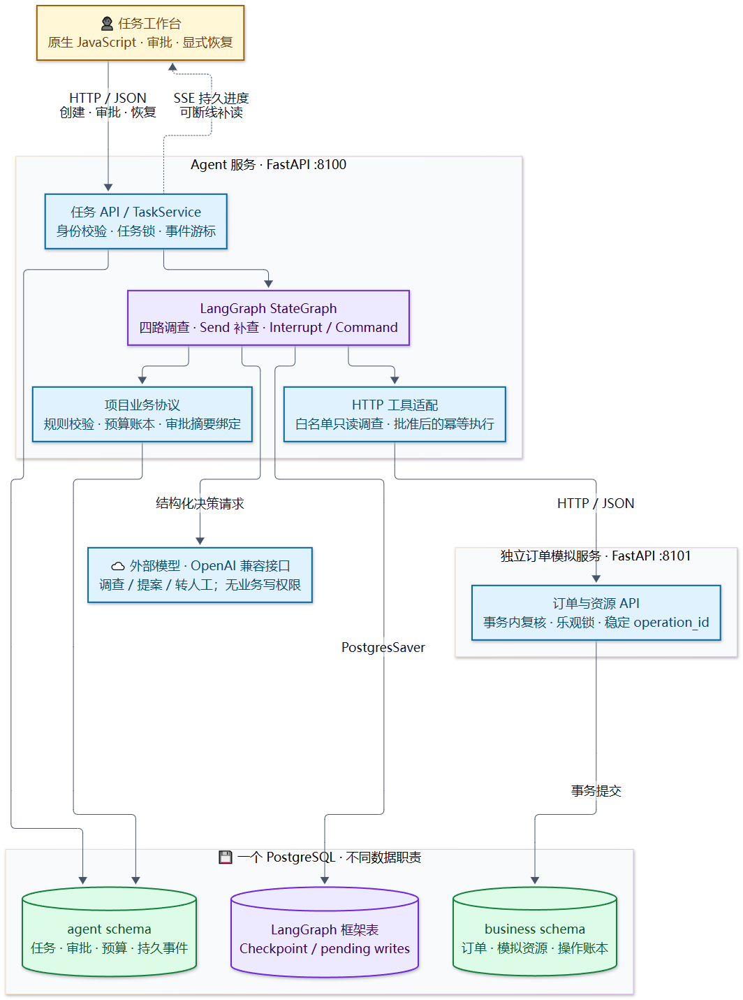
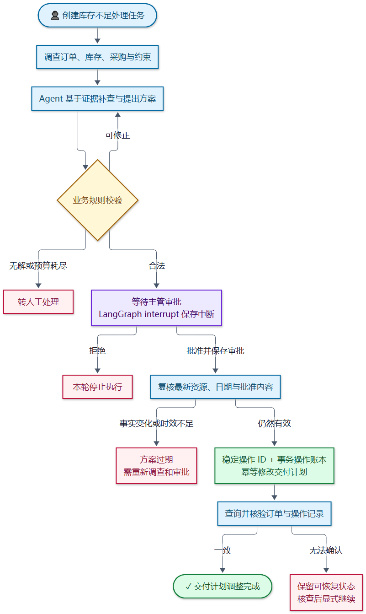
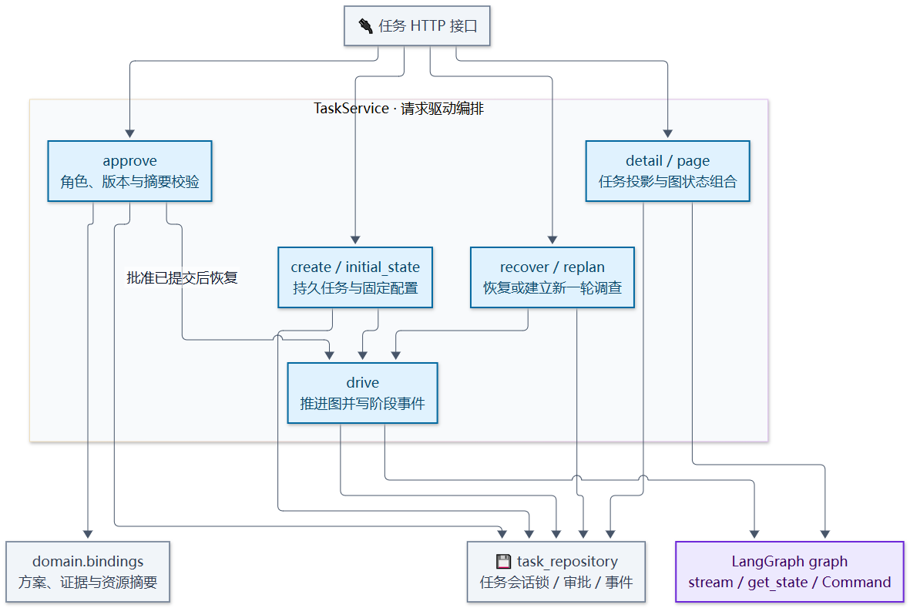
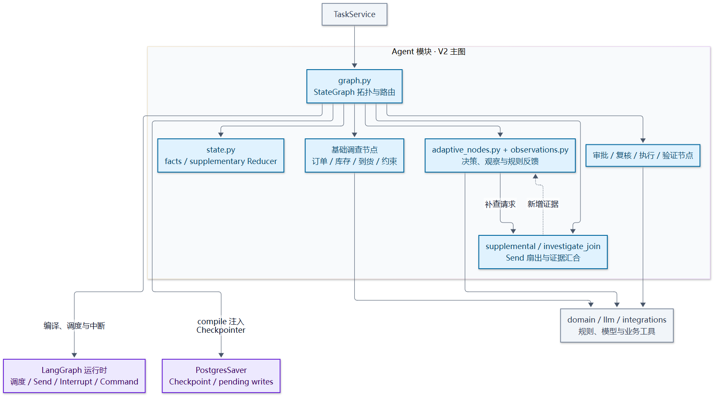
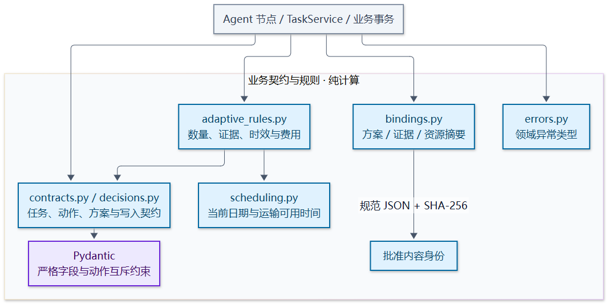
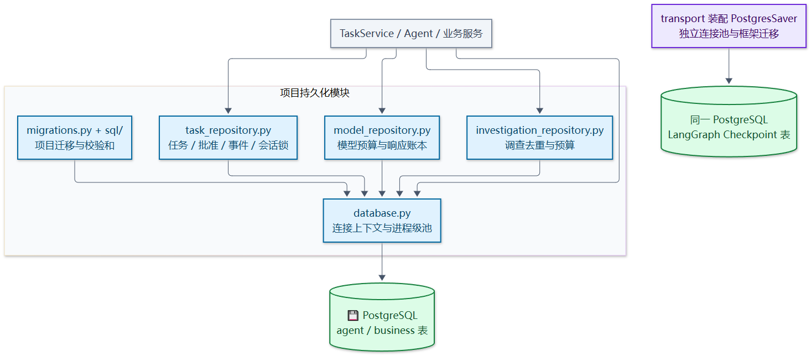
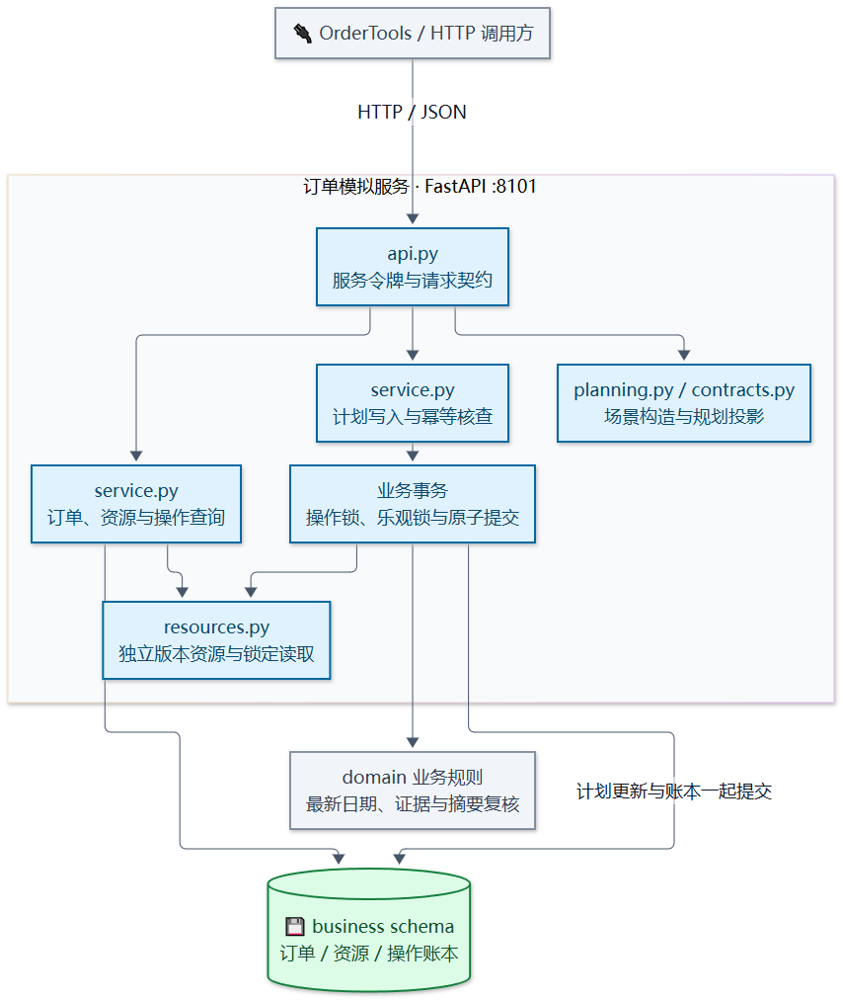
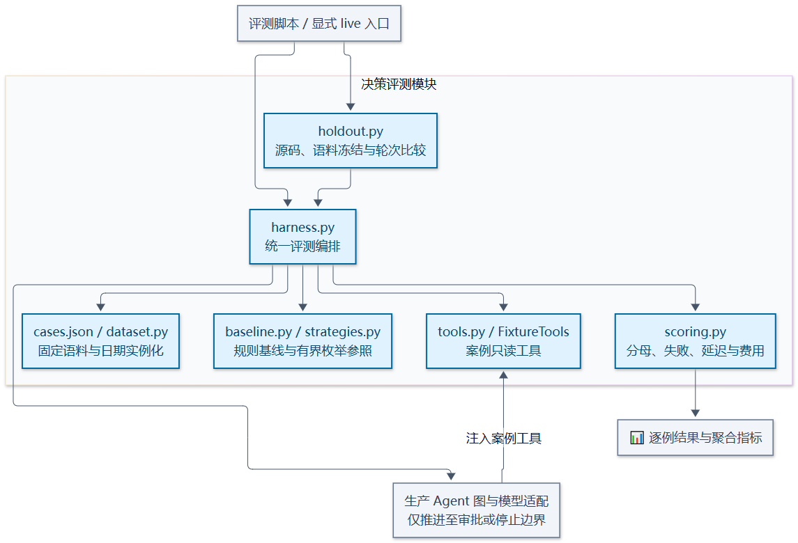
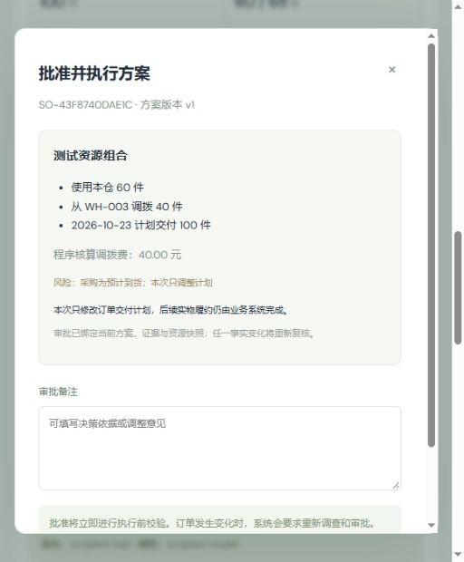
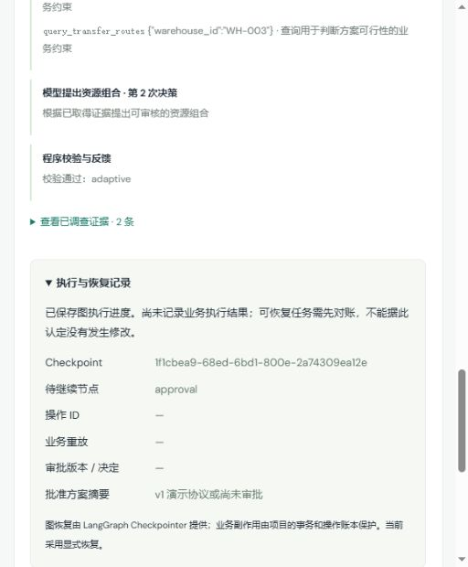

# OrderFlow · 订单异常决策与可靠执行 Agent

基于 **Python、LangGraph、FastAPI 与 PostgreSQL** 的个人工程项目。围绕订单库存不足，完成事实调查、方案决策、人工审批、交付计划调整与结果核验，处理审批等待、资源变化、请求超时和进程退出等异常情况。

模型负责基于证据提出建议；程序负责约束校验和授权边界。即使在审批后重启、业务提交后超时或进程退出，也能通过持久状态和业务操作账本核查、显式恢复。

## 核心功能

- **受约束的 Agent 决策**：固定四路初始调查，模型在白名单内选择补查、提案或转人工；`Send` 动态扇出补查，汇合后复核证据。结构校验、确定性规则、调用预算和无进展限制共同约束循环。
- **可恢复的人工审批**：通过 LangGraph `interrupt` / `Command` 暂停与恢复；项目把批准绑定到方案版本、证据和资源摘要，先保存审批再恢复执行，过期批准不能授权新方案。
- **跨服务副作用恢复**：使用稳定 `operation_id`、参数摘要、事务操作账本和订单乐观锁。业务提交但 Agent 未保存结果时，按同一操作核查与重放，再验证实际订单。
- **可观察、可验证**：工作台通过 SSE 展示持久进度并按游标补读；使用真实 PostgreSQL、独立 HTTP 子进程和进程 kill/restart 验证关键故障窗口。

## 系统架构



[放大 SVG](docs/diagrams/orderflow_architecture.svg) · [Mermaid 源码](docs/diagrams/orderflow_architecture.mmd) · [架构设计](docs/architecture.md)

首页下方提供 [分模块架构与功能流程](#分模块架构与功能流程)，可直接展开查看 10 个模块的组件图及处理链路。

LangGraph 提供调度、Reducer、Checkpoint、Send 和中断恢复；本项目实现业务规则、预算、审批绑定、事务幂等、工作台与故障验收。两个服务使用同一个 PostgreSQL 的不同数据区域，图状态与业务写入之间没有跨服务原子事务。

## 功能流程

```text
异常订单 → 四路调查 → 模型补查 / 提案 → 规则校验与有限修正
        → 人工审批 → 最新资源与日期复核 → 幂等修改计划 → 订单与账本核验
```



规则校验失败时，在预算内补查或修正；无合法建议时转人工。批准后再次检查资源、版本和当前日期，方案过期需重新调查与审批。执行结果未知时保留可恢复状态，核查实际订单和操作账本后再继续。

[业务流程图](docs/diagrams/orderflow_workflow.png) · [流程 SVG](docs/diagrams/orderflow_workflow.svg) · [Mermaid 源码](docs/diagrams/orderflow_workflow.mmd)

## 分模块架构与功能流程

展开各模块可直接查看职责、功能流程和架构图。蓝色表示项目组件，紫色表示框架机制或依赖，绿色表示持久存储，灰色表示模块外部组件。模块是代码职责划分；当前仅 Agent API 与订单模拟 API 分进程部署。

<a id="module-web"></a>
<details>
<summary><strong>01 · 任务工作台：任务展示、审批操作与实时进度</strong></summary>

组织任务列表、证据、候选方案和审批界面，协调页面刷新与事件订阅。

**功能流程**：创建持久任务并取得 ID → 展示任务、发起 SSE 订阅 → 显式请求启动 → 按游标更新进度与详情 → 审批或恢复操作。


[放大 SVG](docs/diagrams/modules/module_web.svg) · [Mermaid 源码](docs/diagrams/modules/module_web.mmd) · [组件说明](docs/modules/web.md)

</details>

<a id="module-transport"></a>
<details>
<summary><strong>02 · HTTP 接口：身份校验、路由与应用装配</strong></summary>

提供任务、订单代理和 SSE 接口，管理应用生命周期、连接池及依赖装配。

**功能流程**：接收 HTTP 请求 → 身份与入参校验 → 调用任务服务或订单工具 → 映射结果与错误；SSE 接口按游标读取已提交事件并返回进度。


[放大 SVG](docs/diagrams/modules/module_transport.svg) · [Mermaid 源码](docs/diagrams/modules/module_transport.mmd) · [组件说明](docs/modules/transport.md)

</details>

<a id="module-services"></a>
<details>
<summary><strong>03 · 任务服务：创建、审批、恢复与重规划</strong></summary>

使用同任务会话锁串行化推进，协调业务审批记录、图状态和面向工作台的任务投影。

**功能流程**：接收任务操作 → 在任务锁下检查状态与权限 → 创建状态或保存有效审批 → 推进或恢复图 → 更新任务状态和阶段事件。重规划产生新一轮调查，需重新审批。



[放大 SVG](docs/diagrams/modules/module_services.svg) · [Mermaid 源码](docs/diagrams/modules/module_services.mmd) · [组件说明](docs/modules/services.md)

</details>

<a id="module-agent"></a>
<details>
<summary><strong>04 · Agent 编排：并行调查、动态补查与执行闸门</strong></summary>

定义 V2 图拓扑、业务节点和状态增量合并；模型在固定图中选择受约束动作。

**功能流程**：四路并行调查并汇合 → 模型选择补查、提案或转人工 → Send 补查与证据汇合 / 规则反馈修正 → 中断等待审批 → 最新事实复核 → 执行与验证。



[放大 SVG](docs/diagrams/modules/module_agent.svg) · [Mermaid 源码](docs/diagrams/modules/module_agent.mmd) · [组件说明](docs/modules/agent.md)

</details>

<a id="module-domain"></a>
<details>
<summary><strong>05 · 业务规则：严格契约、确定性校验与审批绑定</strong></summary>

定义模型动作、候选资源组合、审批与写入契约，复用数量、证据、时效和费用规则。

**功能流程**：接收结构化方案与业务快照 → 校验结构与动作约束 → 计算资源可用日期并核对数量、证据和许可 → 返回规则问题及指标；审批通过规范摘要绑定方案、证据与资源。



[放大 SVG](docs/diagrams/modules/module_domain.svg) · [Mermaid 源码](docs/diagrams/modules/module_domain.mmd) · [组件说明](docs/modules/domain.md)

</details>

<a id="module-llm"></a>
<details>
<summary><strong>06 · 模型接入：结构化决策、调用预算与连接复用</strong></summary>

通过 OpenAI 兼容接口获取调查、提案或转人工决策，管理任务配置、请求截止时间和调用账本。

**功能流程**：构造决策上下文与输入摘要 → 复用同轮已知结果或预留预算 → 在统一截止时间内请求供应商 → 校验 JSON 决策 → 保存响应、usage 与错误信息。缺凭据或请求失败不回退演示答案。


[放大 SVG](docs/diagrams/modules/module_llm.svg) · [Mermaid 源码](docs/diagrams/modules/module_llm.mmd) · [组件说明](docs/modules/llm.md)

</details>

<a id="module-integrations"></a>
<details>
<summary><strong>07 · 工具集成：白名单调查与业务 HTTP 适配</strong></summary>

校验模型调查请求的工具、参数和本订单资源范围，将合法调用映射到固定业务 API。

**功能流程**：接收调查请求 → 校验白名单与资源范围 → 调用固定只读接口 → 返回证据或明确错误。写入由批准并复核后的程序节点调用，模型工具目录不提供写权限。


[放大 SVG](docs/diagrams/modules/module_integrations.svg) · [Mermaid 源码](docs/diagrams/modules/module_integrations.mmd) · [组件说明](docs/modules/integrations.md)

</details>

<a id="module-persistence"></a>
<details>
<summary><strong>08 · 持久化：任务账本、数据库迁移与连接池</strong></summary>

保存任务、批准、模型调用、调查与持久事件，并管理项目 SQL 迁移和数据库连接。

**功能流程**：接收仓储请求 → 取得连接并应用对应锁与约束 → 读写任务或调用账本 → 提交事务 → 提供状态查询与事件补读。LangGraph Checkpoint 通过独立的 PostgresSaver 连接池管理。



[放大 SVG](docs/diagrams/modules/module_persistence.svg) · [Mermaid 源码](docs/diagrams/modules/module_persistence.mmd) · [组件说明](docs/modules/persistence.md)

</details>

<a id="module-simulator"></a>
<details>
<summary><strong>09 · 订单模拟：资源事实、事务幂等与计划写入</strong></summary>

独立提供订单、资源和操作查询接口，在业务事务中复核资源与审批条件并修改交付计划。

**功能流程**：接收稳定操作 ID 与批准方案 → 核查操作账本 → 同参数已执行则重放结果；首次执行则锁定订单和资源 → 校验版本与硬约束 → 原子提交计划与操作结果。



[放大 SVG](docs/diagrams/modules/module_simulator.svg) · [Mermaid 源码](docs/diagrams/modules/module_simulator.mmd) · [组件说明](docs/modules/simulator.md)

</details>

<a id="module-evaluation"></a>
<details>
<summary><strong>10 · 决策评测：固定语料、规则基线与指标汇总</strong></summary>

在固定合成案例上比较规则基线与 Agent 决策，记录合法性、覆盖率、失败、延迟和费用口径。

**功能流程**：加载固定语料并实例化日期 → 执行规则基线与 Agent 决策 → 在审批或停止边界采集结果 → 保留失败及未知费用 → 逐例评分并汇总。评测不批准或修改业务订单。



[放大 SVG](docs/diagrams/modules/module_evaluation.svg) · [Mermaid 源码](docs/diagrams/modules/module_evaluation.mmd) · [组件说明](docs/modules/evaluation.md)

</details>

## 功能界面

以下为模拟数据与测试供应商下的工作台截图。



<details>
<summary>查看任务恢复界面</summary>



</details>

## 快速运行

### Windows 源码运行

需要 Python 3.12；在本仓库根目录执行：

```powershell
Copy-Item .env.example .env
powershell -ExecutionPolicy Bypass -File scripts/setup.ps1
.\.venv\Scripts\python.exe scripts/dev.py start
```

安装脚本下载项目专用 PostgreSQL 17.6 至忽略目录 `.runtime/`，监听本机 `55432`，不注册系统服务。默认数据库账户与角色令牌是公开的本地演示值。启动前确保 `8100`、`8101`、`55432` 未被其他实例占用。

- 工作台：[http://127.0.0.1:8100](http://127.0.0.1:8100)
- Agent API：[http://127.0.0.1:8100/docs](http://127.0.0.1:8100/docs)
- 订单模拟服务：[http://127.0.0.1:8101/docs](http://127.0.0.1:8101/docs)

### Docker Compose

```bash
cp .env.example .env
docker compose up --build
```

Compose 提供数据库与两个服务，数据保存在持久卷。此路径已提供配置，但原项目与本次整理均未运行 Docker 验收。

默认 `PLANNER_MODE=demo` 为明确标注的确定性 V1 演示，不需要模型密钥。启用真实 V2 决策时，在 `.env` 设置 `PLANNER_MODE=llm`、`OPENAI_API_KEY`、`OPENAI_BASE_URL`、`LLM_MODEL`；可参考 [.env.dashscope.example](.env.dashscope.example)。缺少凭据或模型请求失败不会静默回退演示答案。详见 [运行与恢复](docs/runbook.md)。

## 五分钟体验

1. 打开工作台，以默认演示主管身份创建 `SO-2026-001` 的异常任务。
2. 查看调查证据、候选方案、规则原因和处理记录；在演示模式下体验固定候选流程。
3. 批准合法方案，检查订单计划与操作账本的核验结果。
4. 创建另一任务，在批准前使用“模拟订单变化”，观察方案过期；重新调查后需要重新批准。
5. 切换演示操作员身份，确认能创建、查看、恢复任务，但不能审批。

## 代码结构

| 模块 | 源码 | 组件架构 |
| --- | --- | --- |
| 任务工作台 | [web/](web/) | [内部结构与进度订阅](#module-web) |
| HTTP 接口 | [transport/](src/order_agent/transport/) | [身份、路由与应用装配](#module-transport) |
| 任务服务 | [services/](src/order_agent/services/) | [推进、审批与显式恢复](#module-services) |
| Agent 编排 | [agent/](src/order_agent/agent/) | [图状态、节点与动态补查](#module-agent) |
| 业务规则 | [domain/](src/order_agent/domain/) | [契约、校验与摘要绑定](#module-domain) |
| 模型接入 | [llm/](src/order_agent/llm/) | [模型协议、预算与传输](#module-llm) |
| 工具集成 | [integrations/](src/order_agent/integrations/) | [白名单调查与 HTTP 适配](#module-integrations) |
| 持久化 | [persistence/](src/order_agent/persistence/) | [仓储、迁移与连接池](#module-persistence) |
| 订单模拟 | [simulator/](src/order_agent/simulator/) | [业务接口、资源与事务](#module-simulator) |
| 决策评测 | [evaluation/](src/order_agent/evaluation/) | [语料、基线与指标](#module-evaluation) |

[自动化测试](tests/) · [总体架构](docs/architecture.md) · [运行手册](docs/runbook.md)

## 范围与归属

这是个人模拟项目，修改的是订单交付计划，不执行真实采购、调拨、库存预留、出库或物流履约。当前采用请求驱动和显式恢复，没有独立 Worker、自动接管、共享库存分配或完整多租户身份系统；不宣称生产 SLA 或跨服务 exactly-once。

测试覆盖规则、审批、事务幂等、真实进程故障恢复和前端进度；运行方式见 [运行说明](docs/runbook.md#测试)。离线演示与脚本化供应商测试验证工程机制，不代表真实 LLM 质量。固定合成案例不能推导真实企业收益，尚未证明 Agent 整体优于规则基线。

Python 依赖由 `pyproject.toml` 与 `uv.lock` 固定；保留的上游许可和参考范围见 [THIRD_PARTY_NOTICES.md](THIRD_PARTY_NOTICES.md) 及 [licenses/](licenses/)。
