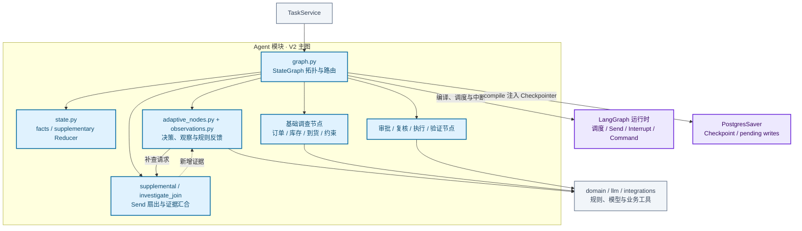

# Agent 图编排模块架构

定义 V2 图拓扑、状态增量合并和业务节点。四路初始调查固定并行；模型提出的补查请求由 Send 动态扇出，在汇合节点集中合并证据并校验版本。

[放大 SVG](../diagrams/modules/module_agent.svg) · [Mermaid 源码](../diagrams/modules/module_agent.mmd) · [模块目录](README.md)

## 主要组件

| 组件 | 职责 |
| --- | --- |
| [graph.py](../../src/order_agent/agent/graph.py) | 图拓扑、固定并行和 Send 路由 |
| [state.py](../../src/order_agent/agent/state.py) | State、Reducer 与稳定操作身份 |
| [adaptive_nodes.py](../../src/order_agent/agent/adaptive_nodes.py) | V2 决策、补查、规则反馈与资源复核 |
| [nodes.py](../../src/order_agent/agent/nodes.py) | 基础调查、V1 兼容及审批执行节点 |
| [observations.py](../../src/order_agent/agent/observations.py) | 模型可见事实、查询身份与无解反证 |

## 模块边界

模型只选择受约束动作，图的拓扑和执行闸门由程序定义。LangGraph 提供调度、Reducer、Checkpoint 与中断机制，项目定义节点业务和审批执行协议。

查看 Mermaid 图源码

