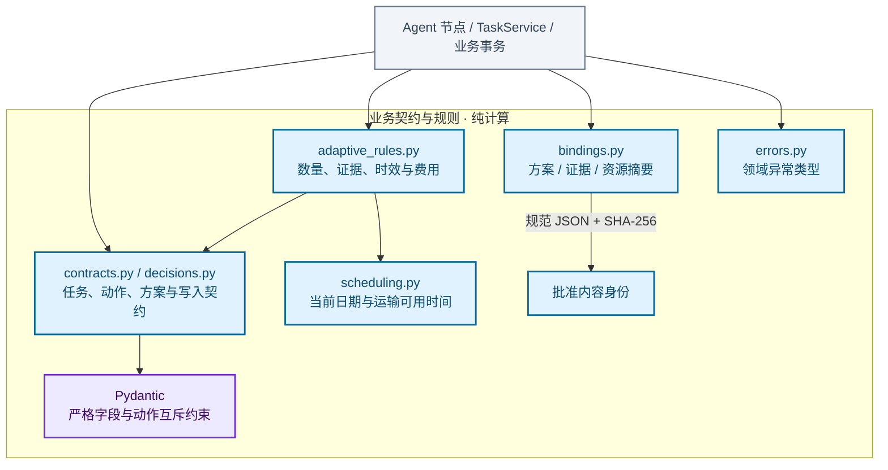

# 业务契约与确定性规则模块架构

定义模型动作、候选资源组合、批准与写入契约，确定性计算资源可用时间、数量、交付合法性和费用，并生成方案、证据与资源的规范摘要。

[放大 SVG](../diagrams/modules/module_domain.svg) · [Mermaid 源码](../diagrams/modules/module_domain.mmd) · [模块目录](README.md)

## 主要组件

| 组件 | 职责 |
| --- | --- |
| [contracts.py](../../src/order_agent/domain/contracts.py) | 任务、批准与 V1 兼容契约 |
| [decisions.py](../../src/order_agent/domain/decisions.py) | 互斥动作、资源分配与 V2 写入契约 |
| [adaptive_rules.py](../../src/order_agent/domain/adaptive_rules.py) | V2 数量、证据、日期与费用校验 |
| [scheduling.py](../../src/order_agent/domain/scheduling.py) | 规划起点与调拨可用日期 |
| [bindings.py](../../src/order_agent/domain/bindings.py) | 稳定摘要与审批绑定 |
| [errors.py](../../src/order_agent/domain/errors.py) | 领域异常类型 |

## 模块边界

规则不访问数据库、不发起 HTTP 或模型调用；Agent 校验和业务事务复核复用同一套规则。读取时间不参与资源身份摘要，日期时效单独检查。

查看 Mermaid 图源码

