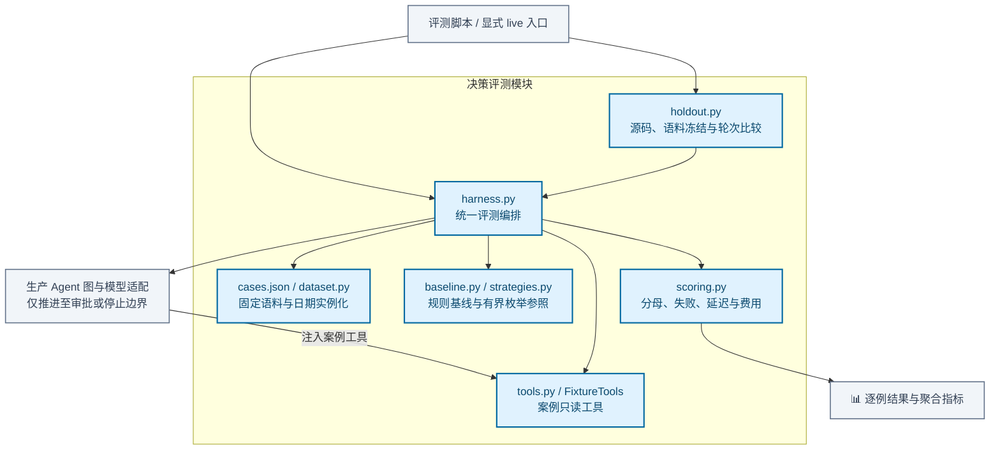

# 决策评测模块架构

使用固定合成语料与确定性参照，对比规则基线和 Agent 决策，记录合法性、覆盖率、延迟、调用与费用口径。Agent 路径复用生产图和模型适配，仅运行到审批或停止边界。

[放大 SVG](../diagrams/modules/module_evaluation.svg) · [Mermaid 源码](../diagrams/modules/module_evaluation.mmd) · [模块目录](README.md)

## 主要组件

| 组件 | 职责 |
| --- | --- |
| [cases.json](../../src/order_agent/evaluation/cases.json) | 固定合成语料 |
| [dataset.py](../../src/order_agent/evaluation/dataset.py) | 语料加载、摘要与相对日期实例化 |
| [harness.py](../../src/order_agent/evaluation/harness.py) | 规则与 Agent 的统一评测入口 |
| [baseline.py](../../src/order_agent/evaluation/baseline.py) | 确定性规则基线 |
| [strategies.py](../../src/order_agent/evaluation/strategies.py) | 有限资源枚举参照 |
| [scoring.py](../../src/order_agent/evaluation/scoring.py) | 逐例判分、汇总与费用口径 |
| [holdout.py](../../src/order_agent/evaluation/holdout.py) | 冻结清单与多轮结果比较 |
| [tools.py](../../src/order_agent/evaluation/tools.py) | 基于案例的只读工具替身 |

## 模块边界

评测不批准或修改业务订单。脚本化响应验证机制，真实模型批次需显式运行；失败保留在分母中，未知 usage 和费用不能按零计，也不预设 Agent 优于规则。

查看 Mermaid 图源码

