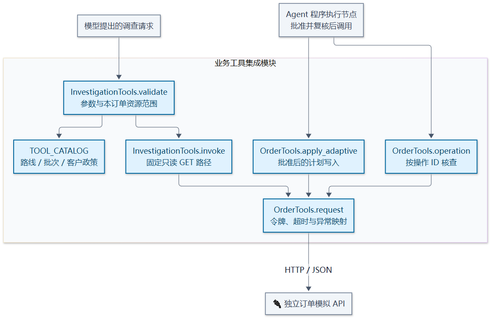
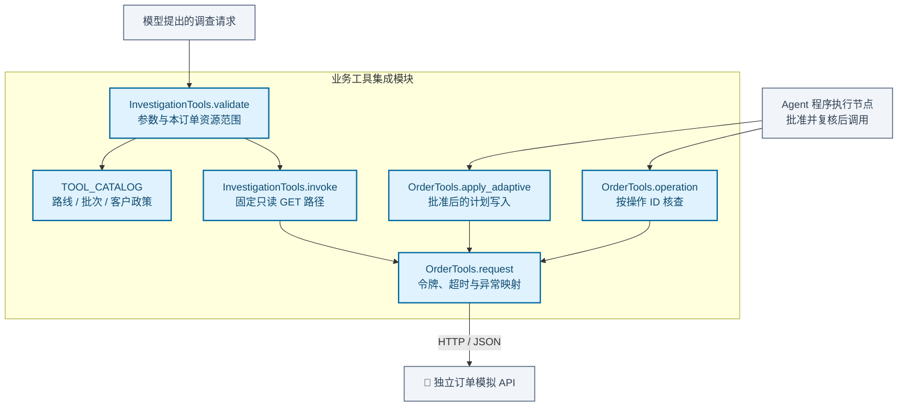

# 业务工具与受限调查模块架构

把业务工具调用转换为独立订单服务的 HTTP 契约，并限制模型可请求的只读调查工具、参数和资源范围。查询与批准后的执行共用客户端适配，写入不暴露给模型工具目录。

[放大 SVG](../diagrams/modules/module_integrations.svg) · [Mermaid 源码](../diagrams/modules/module_integrations.mmd) · [模块目录](README.md)

## 主要组件

| 组件 | 职责 |
| --- | --- |
| [investigation.py](../../src/order_agent/integrations/investigation.py) | TOOL_CATALOG、参数白名单、资源范围与只读路径 |
| [order_client.py](../../src/order_agent/integrations/order_client.py) | OrderTools、身份令牌、HTTP 错误映射与操作查询 |

## 模块边界

模型不能传入任意 URL、SQL 或其他订单 ID。HTTP 超时和业务冲突映射为明确异常，结果未知时由上层按稳定操作身份核查。

查看 Mermaid 图源码

