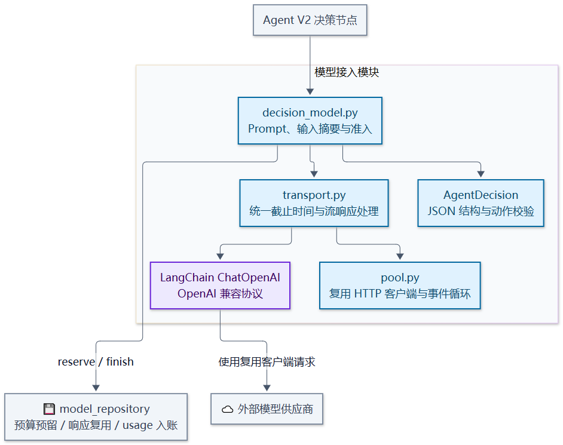
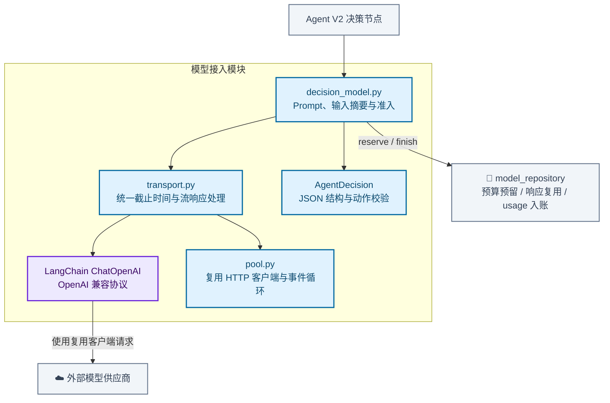

# 模型接入与调用治理模块架构

构造结构化决策请求，固定任务模型配置，预留调用预算并复用已入账响应。传输层通过 LangChain ChatOpenAI 对接兼容接口，复用进程级 HTTP 连接并共享调用截止时间。

[放大 SVG](../diagrams/modules/module_llm.svg) · [Mermaid 源码](../diagrams/modules/module_llm.mmd) · [模块目录](README.md)

## 主要组件

| 组件 | 职责 |
| --- | --- |
| [decision_model.py](../../src/order_agent/llm/decision_model.py) | DecisionModel、JSON 契约、预算准入与结果入账 |
| [transport.py](../../src/order_agent/llm/transport.py) | ChatOpenAI 请求、流响应与统一截止时间 |
| [pool.py](../../src/order_agent/llm/pool.py) | 进程级 HTTP 客户端和专用事件循环 |
| [planner.py](../../src/order_agent/llm/planner.py) | V1 确定性候选生成与兼容入口 |
| [model_repository.py](../../src/order_agent/persistence/model_repository.py) | 预算和同轮响应重放账本 |

## 模块边界

模型没有业务写权限。模型失败不回退演示答案；未知 usage 保留预留量，同轮响应只在输入摘要一致时复用，不承诺供应商侧只调用或计费一次。

查看 Mermaid 图源码

