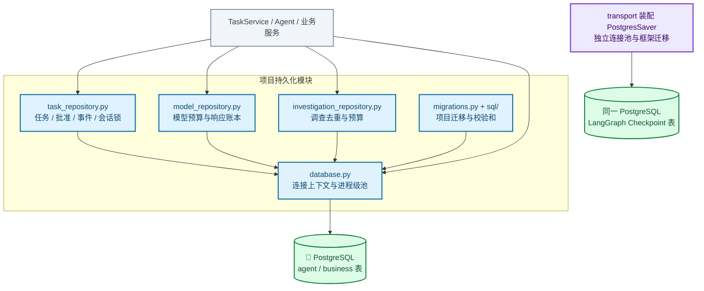

# 持久化与数据库访问模块架构

管理项目连接池、版本化 SQL 迁移及任务、审批、模型和调查账本。任务推进使用会话锁，事件写入和预算准入各使用独立事务锁与约束。

[放大 SVG](../diagrams/modules/module_persistence.svg) · [Mermaid 源码](../diagrams/modules/module_persistence.mmd) · [模块目录](README.md)

## 主要组件

| 组件 | 职责 |
| --- | --- |
| [database.py](../../src/order_agent/persistence/database.py) | 按 DSN 复用连接池、连接上下文与关闭 |
| [migrations.py](../../src/order_agent/persistence/migrations.py) | 迁移顺序、校验和与数据库升级 |
| [task_repository.py](../../src/order_agent/persistence/task_repository.py) | 任务、批准、事件和会话锁 |
| [model_repository.py](../../src/order_agent/persistence/model_repository.py) | 模型预算预留、usage 与响应账本 |
| [investigation_repository.py](../../src/order_agent/persistence/investigation_repository.py) | 调查去重、预算及完成记录 |
|  | agent / business 版本化迁移 |

## 模块边界

项目迁移只管理业务和 Agent 表；LangGraph 自行管理 Checkpoint 表和迁移，PostgresSaver 在 transport 中通过另一连接池装配。三类表位于同一个 PostgreSQL。

查看 Mermaid 图源码

