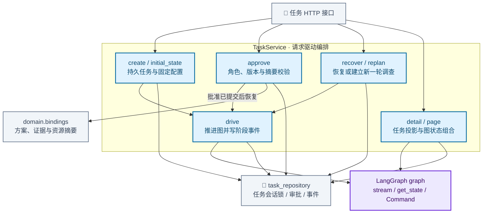

# 任务与审批服务模块架构

协调创建、审批、恢复、重规划和任务详情，使用同任务会话锁串行化推进。审批先持久化，随后恢复图；详情结合任务投影与 Checkpoint 确定可恢复状态。

[放大 SVG](../diagrams/modules/module_services.svg) · [Mermaid 源码](../diagrams/modules/module_services.mmd) · [模块目录](README.md)

## 主要组件

| 组件 | 职责 |
| --- | --- |
| [tasks.py](../../src/order_agent/services/tasks.py) | TaskService 与初始状态、驱动、审批和恢复 |
| [task_repository.py](../../src/order_agent/persistence/task_repository.py) | 任务锁、任务投影、审批及持久事件 |
| [bindings.py](../../src/order_agent/domain/bindings.py) | 批准内容的摘要绑定 |

## 模块边界

任务服务采用请求驱动，没有后台 Worker。审批记录、图 Checkpoint 和外部业务写入是不同的提交边界。

查看 Mermaid 图源码

