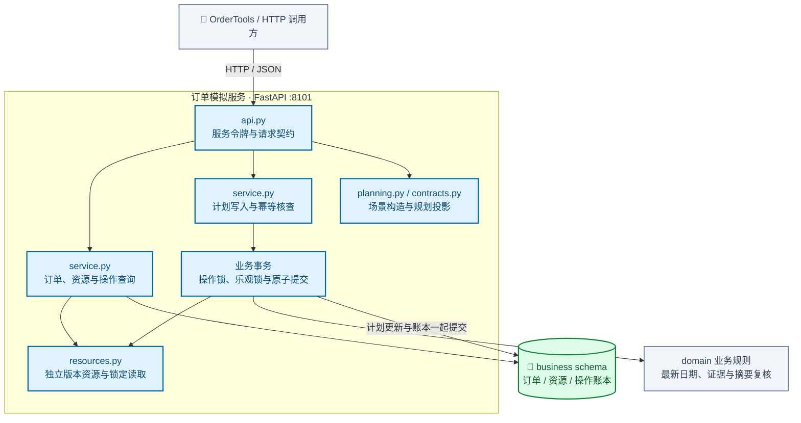

# 独立订单模拟服务模块架构

通过独立 FastAPI 进程提供订单事实、资源调查和计划写入接口。写入时按操作 ID 核查账本，在业务事务内锁定订单与资源、复核批准条件，再同时提交计划和操作结果。

[放大 SVG](../diagrams/modules/module_simulator.svg) · [Mermaid 源码](../diagrams/modules/module_simulator.mmd) · [模块目录](README.md)

## 主要组件

| 组件 | 职责 |
| --- | --- |
| [api.py](../../src/order_agent/simulator/api.py) | 服务身份校验、业务查询与写入接口 |
| [service.py](../../src/order_agent/simulator/service.py) | 业务查询、方案写入、操作账本与事务 |
| [resources.py](../../src/order_agent/simulator/resources.py) | 独立版本资源、锁定读取与场景变更 |
| [planning.py](../../src/order_agent/simulator/planning.py) | 模拟规划快照和概览投影 |
| [contracts.py](../../src/order_agent/simulator/contracts.py) | 场景与资源变更契约 |

## 模块边界

修改范围是模拟订单交付计划，不扣减或预留共享库存，不代表真实采购、调拨或出库。业务事务独立于 Agent Checkpoint。

查看 Mermaid 图源码

