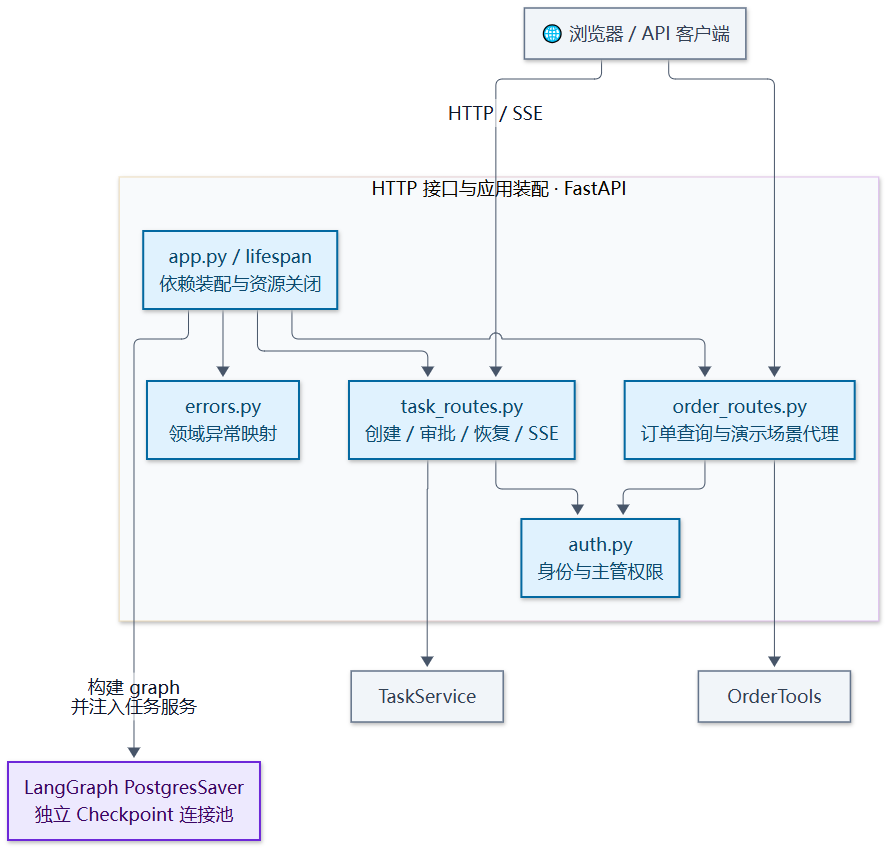
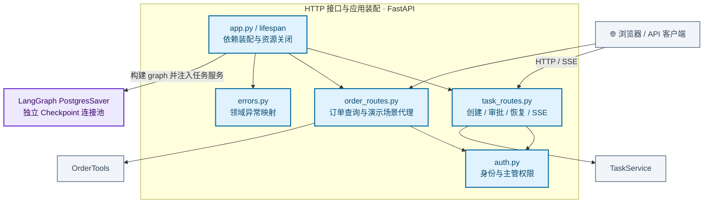

# HTTP 接口与应用装配模块架构

提供 FastAPI 任务接口、订单代理接口和进度订阅，完成身份校验、错误映射及依赖装配。应用生命周期分别管理 Checkpoint 连接池与其他进程级资源。

[放大 SVG](../diagrams/modules/module_transport.svg) · [Mermaid 源码](../diagrams/modules/module_transport.mmd) · [模块目录](README.md)

## 主要组件

| 组件 | 职责 |
| --- | --- |
| [app.py](../../src/order_agent/transport/app.py) | 生命周期、图和任务服务装配、静态资源 |
| [auth.py](../../src/order_agent/transport/auth.py) | 演示角色令牌与主管权限 |
| [task_routes.py](../../src/order_agent/transport/task_routes.py) | 任务接口、分页和 SSE |
| [order_routes.py](../../src/order_agent/transport/order_routes.py) | 订单代理与演示场景入口 |
| [errors.py](../../src/order_agent/transport/errors.py) | 领域错误到 HTTP 响应映射 |

## 模块边界

接口层处理身份和协议，任务流转交给 TaskService；SSE 从持久事件日志读取，不承担任务执行。

查看 Mermaid 图源码

