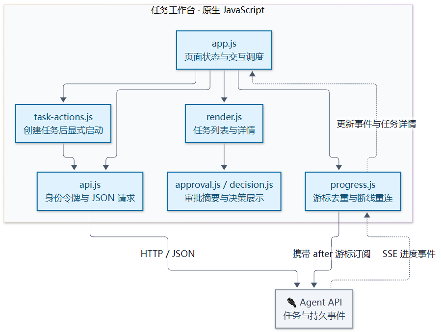
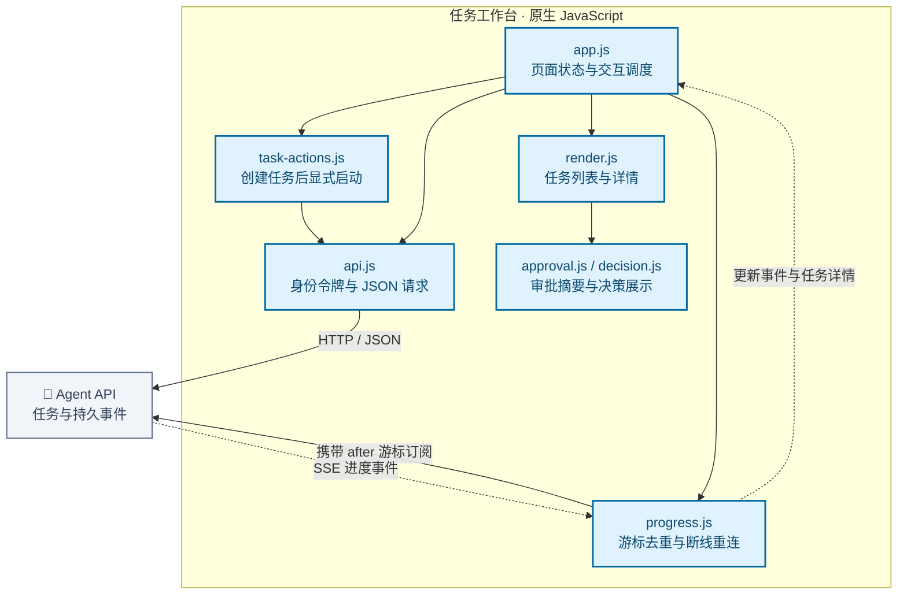

# 任务工作台模块架构

组织任务列表、调查证据、候选方案、主管审批与恢复操作。页面状态和进度订阅相互配合，慢请求期间仍可展示节点进度。

[放大 SVG](../diagrams/modules/module_web.svg) · [Mermaid 源码](../diagrams/modules/module_web.mmd) · [模块目录](README.md)

## 主要组件

| 组件 | 职责 |
| --- | --- |
| [app.js](../../web/app.js) | 页面状态、交互与刷新调度 |
| [task-actions.js](../../web/task-actions.js) | 先取得任务 ID，再订阅与启动 |
| [api.js](../../web/api.js) | 携带身份令牌的 HTTP 请求 |
| [progress.js](../../web/progress.js) | SSE 帧解析、游标去重与重连 |
| [render.js](../../web/render.js) | 任务列表与详情渲染 |
| [approval.js](../../web/approval.js) | 审批动作摘要与恢复入口 |
| [decision.js](../../web/decision.js) | 决策过程展示 |

## 模块边界

工作台发起业务请求并展示服务端状态；SSE 重连只恢复观察，不重新批准或重做业务操作。

查看 Mermaid 图源码

